<div align="center">

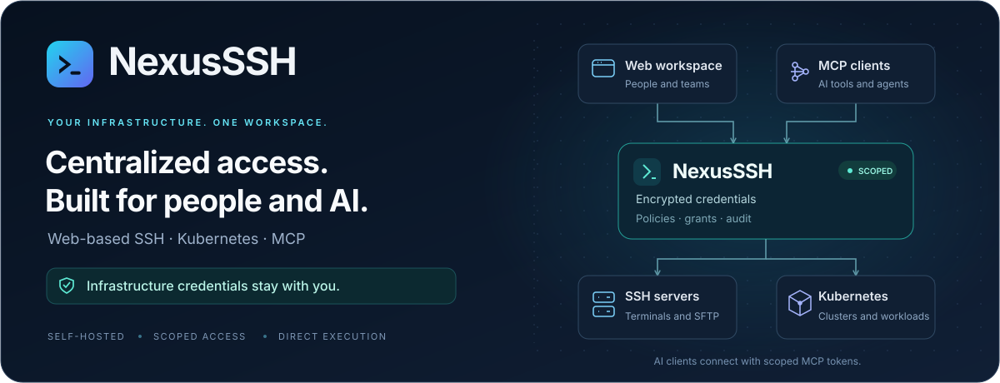

[](https://github.com/nooblk-98/nexusssh/actions/workflows/checks.yml)
[](CHANGELOG.md)
[](https://github.com/nooblk-98/nexusssh/pkgs/container/nexusssh)
[](#getting-started)
[](#connect-an-ai-client-through-mcp)
[](https://www.npmjs.com/package/nexusssh-mcp)
[](docs/KUBERNETES.md)

⭐ If NexusSSH is useful to you, star the repository. It helps others find it.

[Overview](#overview) · [Features](#features) · [Screenshots](#screenshots) · [Getting started](#getting-started) · [AI and MCP](#connect-an-ai-client-through-mcp) · [Documentation](#documentation)

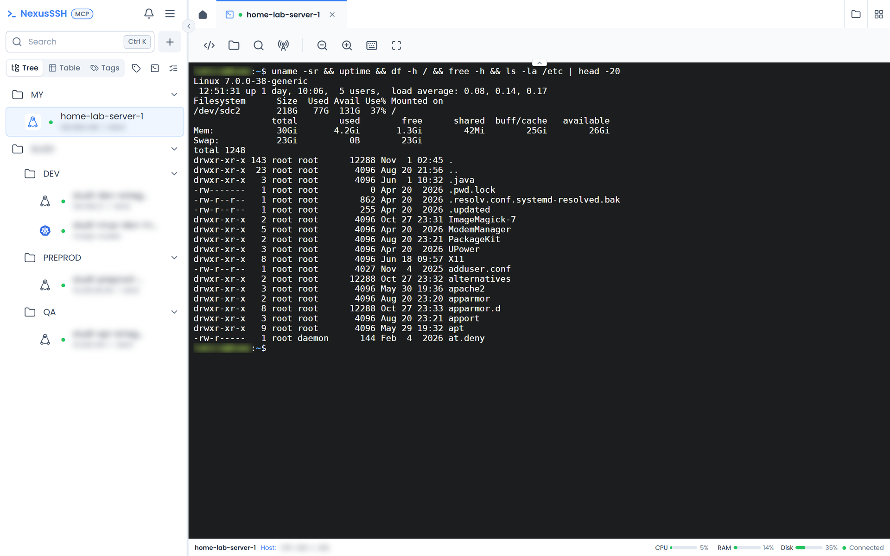

</div>

## Overview

NexusSSH is a self-hosted workspace for your servers and Kubernetes clusters. Save your connections once, then open terminals, browse files, run cluster commands, and manage team access from a browser.

It also ships with a built-in [Model Context Protocol (MCP)](https://modelcontextprotocol.io) server, so AI assistants can work on your infrastructure **without ever receiving your SSH passwords, private keys, Kubernetes tokens, or kubeconfig files**. Credentials stay encrypted on your deployment. AI clients connect with scoped, expiring, revocable tokens, and NexusSSH runs only the operations you have granted them. Sensitive operations wait for human approval.

## Features

| Area                       | Capabilities                                                                                                                                                 |
| -------------------------- | ------------------------------------------------------------------------------------------------------------------------------------------------------------ |
| **Centralized workspace**  | Nested folders for servers and clusters, search, tags, favorites, recent connections, split views, a command palette, and saved workspace presets.          |
| **Browser SSH**            | Interactive terminals with pinned host keys, session resume, snippets, search, command suggestions, and broadcast input across sessions.                     |
| **Remote files**           | SFTP browsing, resumable uploads with progress, and a Monaco editor with change previews, conflict detection, and optional encrypted file history.            |
| **Kubernetes**             | Kubeconfig import with context and namespace selection, a cluster command console, resource browsing, and pod logs.                                          |
| **AI access through MCP**  | Per-agent server, cluster, and tool grants, human approval for commands and mutations, call limits, token revocation, and per-agent activity.                |
| **Private infrastructure** | Reach targets through saved WireGuard profiles, an SSH bastion, or both. The same routes serve browser sessions and MCP operations.                          |
| **Team access**            | Users, teams, operation grants, TOTP MFA with recovery codes, and optional OIDC single sign-on.                                                              |
| **Operations**             | Versioned runbooks, staged connection diagnostics, readiness checks, a searchable audit log, and optional scheduled encrypted backups with restore rehearsal. |

## Screenshots

<table>
  <tr>
    <td width="50%" valign="top">
      <a href="docs/assets/screenshots/sftp-file-browser.png">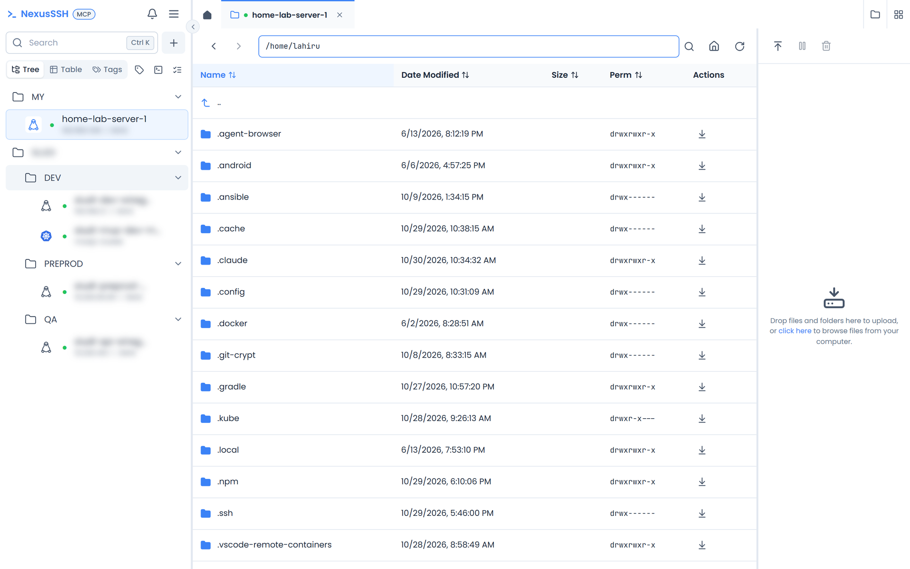</a>
      <p align="center"><b>SFTP file browser</b><br/><sub>Browse, upload, download, and edit remote files in the browser.</sub></p>
    </td>
    <td width="50%" valign="top">
      <a href="docs/assets/screenshots/kubernetes-console.png">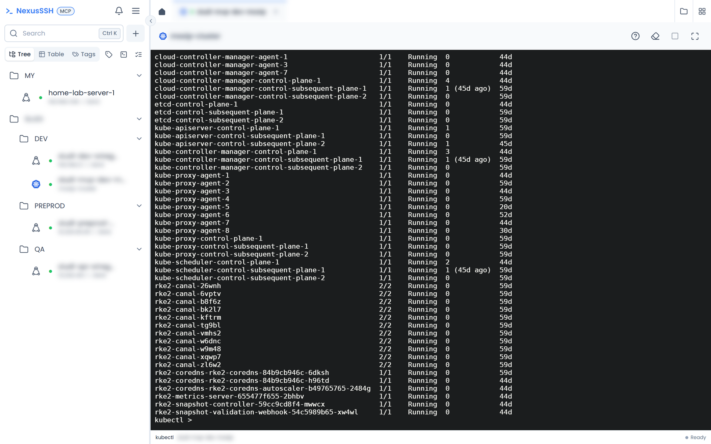</a>
      <p align="center"><b>Kubernetes console</b><br/><sub>Run kubectl-style commands against saved clusters, with no local kubeconfig.</sub></p>
    </td>
  </tr>
  <tr>
    <td width="50%" valign="top">
      <a href="docs/assets/screenshots/mcp-server.png">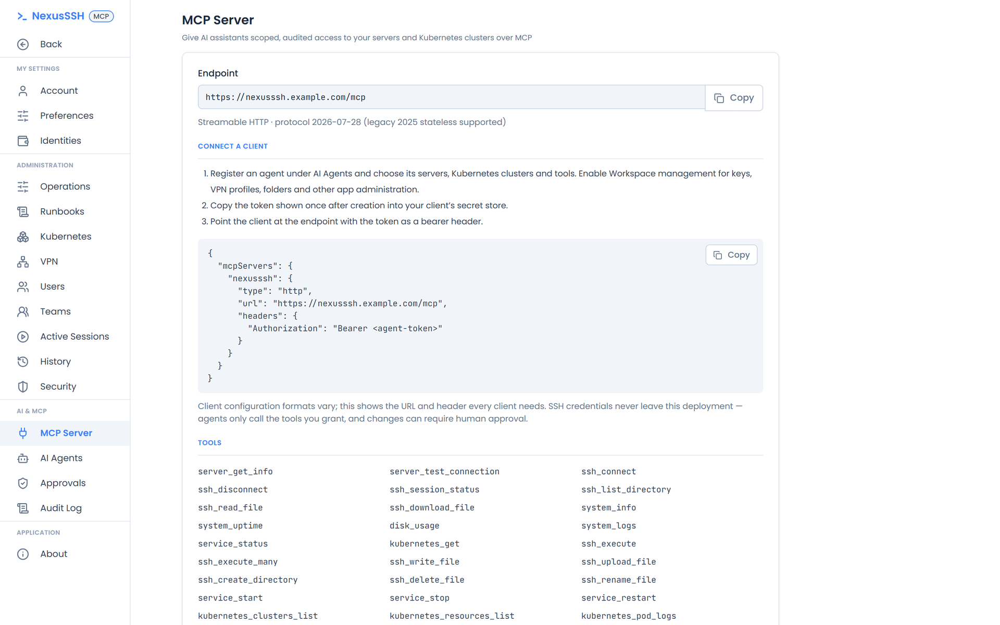</a>
      <p align="center"><b>Built-in MCP server</b><br/><sub>Point any remote HTTP MCP client at one endpoint with a scoped token.</sub></p>
    </td>
    <td width="50%" valign="top">
      <a href="docs/assets/screenshots/ai-agents.png">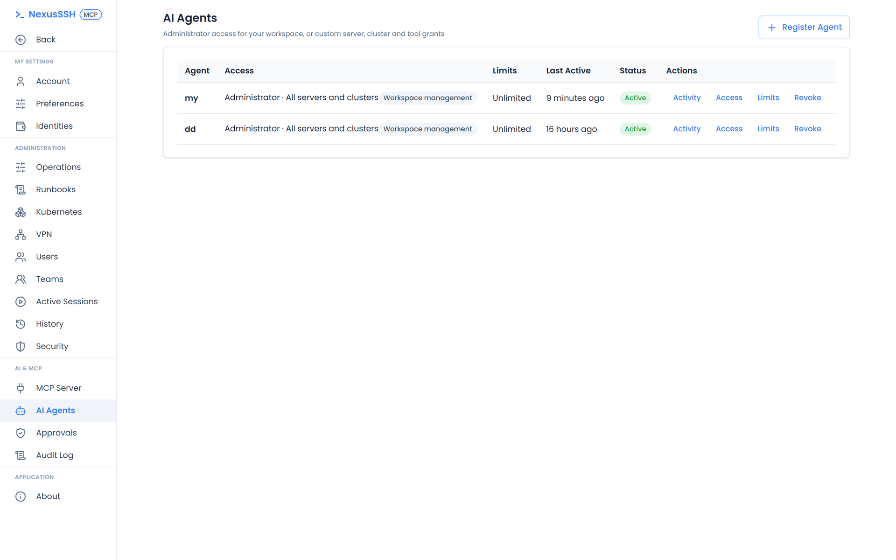</a>
      <p align="center"><b>AI agents</b><br/><sub>Grant, limit, and revoke each agent's access to servers, clusters, and tools.</sub></p>
    </td>
  </tr>
  <tr>
    <td width="50%" valign="top">
      <a href="docs/assets/screenshots/audit-log.png">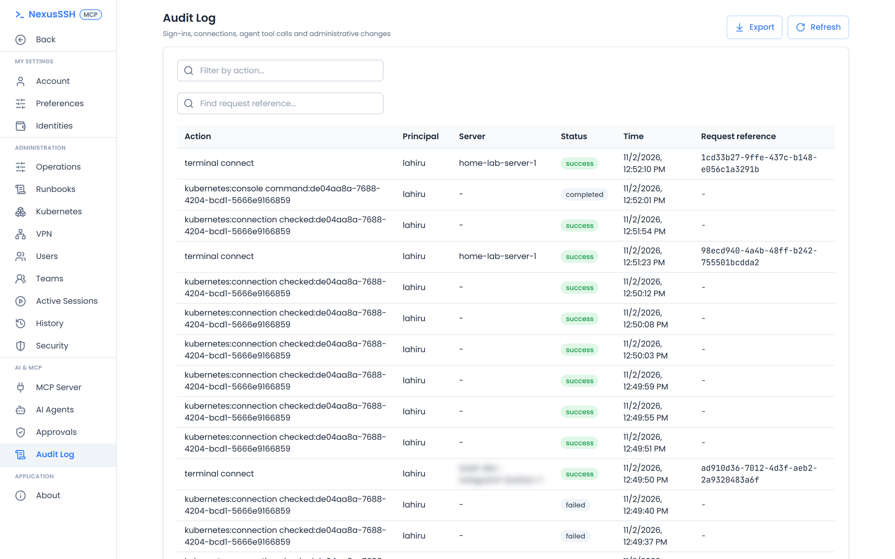</a>
      <p align="center"><b>Audit log</b><br/><sub>Every sign-in, connection, and agent tool call, with request references.</sub></p>
    </td>
    <td width="50%" valign="top">
      <a href="docs/assets/screenshots/vpn-profiles.png">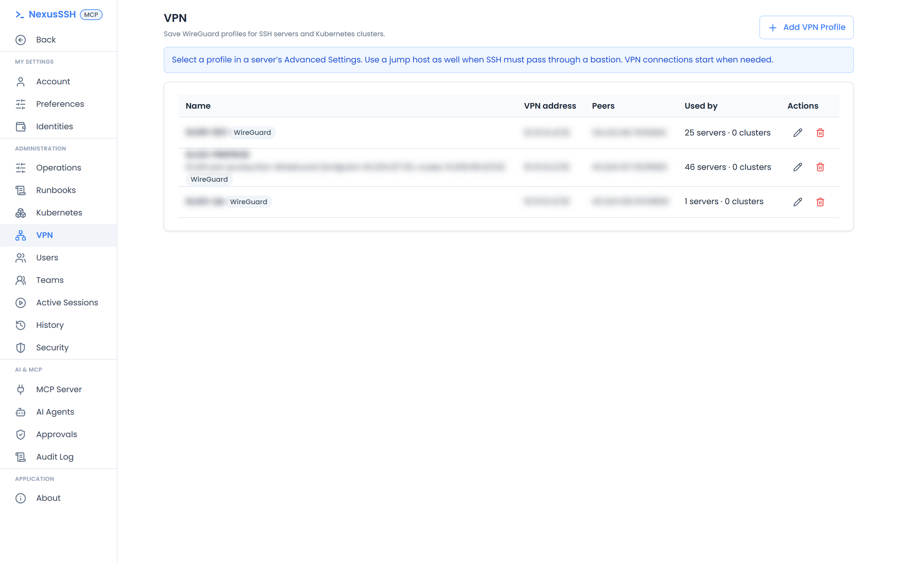</a>
      <p align="center"><b>WireGuard routes</b><br/><sub>Reach private networks through saved VPN profiles and bastions.</sub></p>
    </td>
  </tr>
  <tr>
    <td width="50%" valign="top">
      <a href="docs/assets/screenshots/command-palette.png">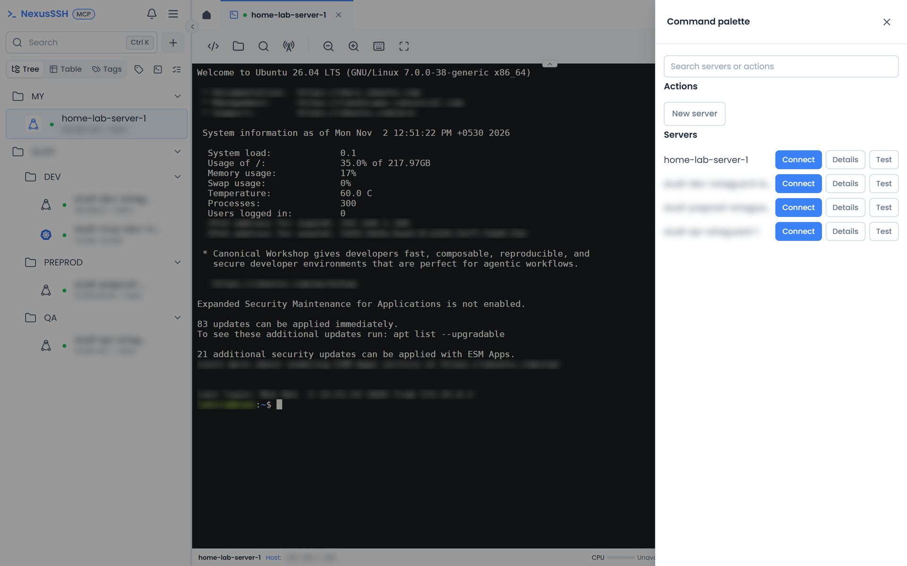</a>
      <p align="center"><b>Command palette</b><br/><sub>Press <kbd>Ctrl</kbd>+<kbd>K</kbd> to connect, inspect, or test any server.</sub></p>
    </td>
    <td width="50%" valign="top">
      <a href="docs/assets/screenshots/security-settings.png">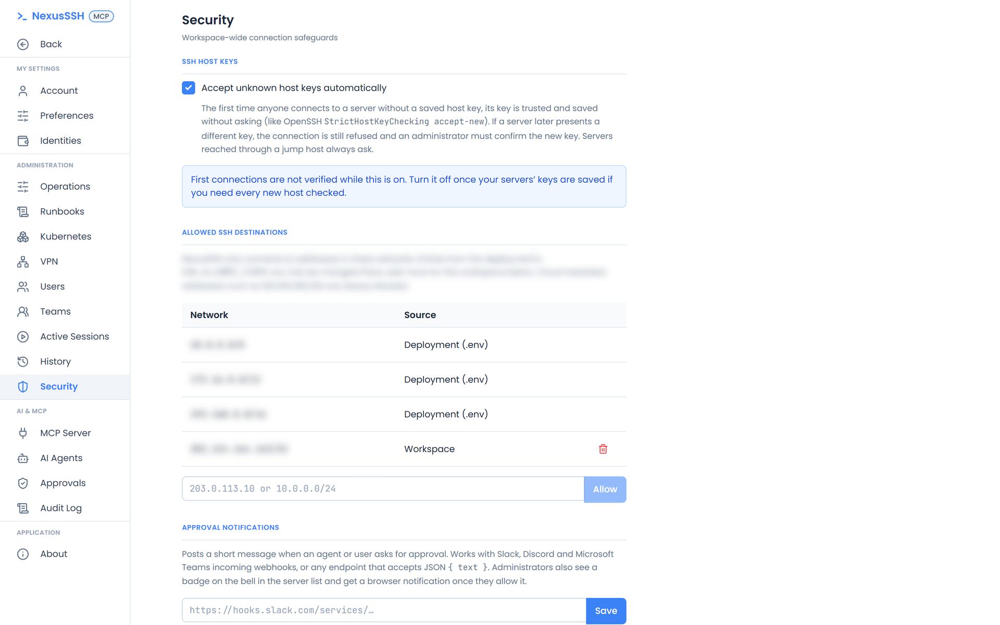</a>
      <p align="center"><b>Connection safeguards</b><br/><sub>Host key policy, destination allowlists, and approval notifications.</sub></p>
    </td>
  </tr>
</table>

## Getting started

### Prerequisites

- [Docker](https://docs.docker.com/get-docker/) with Linux containers, on `amd64` or `arm64`
- Docker Compose **2.24.4 or newer**

### Deploy with one command

```sh
curl -fsSL https://raw.githubusercontent.com/nooblk-98/nexusssh/main/docker-compose.yml -o docker-compose.yml && docker compose up -d
```

This pulls the prebuilt image from GitHub Container Registry and starts two containers: `nexusssh` (web UI, API, MCP server, and SSH worker behind one gateway) and `redis`. No `.env` file is needed to start.

| Image tag                                 | Built from                                       |
| ----------------------------------------- | ------------------------------------------------ |
| `ghcr.io/nooblk-98/nexusssh:latest`       | The newest stable release (default)              |
| `ghcr.io/nooblk-98/nexusssh:v0.3.0`       | A specific release, also published as `0.3.0`    |
| `ghcr.io/nooblk-98/nexusssh:0.3`          | The newest patch release of a minor version      |
| `ghcr.io/nooblk-98/nexusssh:development`  | The `development` branch, for early testing      |
| `ghcr.io/nooblk-98/nexusssh:sha-<commit>` | An exact commit, for pinning and rollback        |

To run another tag, set `NEXUSSSH_IMAGE`, for example `NEXUSSSH_IMAGE=ghcr.io/nooblk-98/nexusssh:development docker compose up -d`. To upgrade, run `docker compose pull && docker compose up -d`.

### First sign-in

1. Open `http://<your-host>:8080`.
2. Copy the first-run setup token from `docker compose logs nexusssh`, then create your owner account. No default password is shipped.
3. Add an SSH identity and a server, or import a Kubernetes kubeconfig. Verify SSH host fingerprints through a trusted console before saving them.
4. Under **Settings → Security**, allow the networks your targets live in, then test the connection. Pick a WireGuard profile or bastion if the target needs one.
5. Open a terminal, an SFTP session, or a cluster console.

Installation secrets are generated on first start and kept in the `nexusssh_secrets` volume. Application records live in `nexusssh_data`.

> [!IMPORTANT]
> Back up both volumes. Losing the encryption key makes saved credentials unrecoverable, and `docker compose down -v` deletes them.

> [!WARNING]
> The app serves plain HTTP on port `8080`. For a shared or internet-facing installation, put a TLS-terminating reverse proxy in front, set a stable `APP_URL`, and narrow `SSH_ALLOWED_CIDRS` by following the [deployment guide](docs/DEPLOYMENT.md).

### Optional settings

`docker-compose.yml` sets only what the container needs. Set these from your shell or a `.env` file next to it:

| Variable            | Default                                        | Purpose                                                                                                          |
| ------------------- | ---------------------------------------------- | ---------------------------------------------------------------------------------------------------------------- |
| `APP_URL`           | Unset: serve whatever address the app is reached on | Public HTTPS address, such as `https://nexusssh.example.com`. Fixes the allowed browser origin and the MCP endpoint (`<APP_URL>/mcp`). |
| `HTTP_PORT`         | `8080`                                         | Host port the gateway publishes.                                                                                 |
| `NEXUSSSH_IMAGE`    | `ghcr.io/nooblk-98/nexusssh:latest`            | Image tag to run.                                                                                                |

Everything else is optional and has a working default. To set any of these, create a `docker-compose.override.yml` beside `docker-compose.yml`. Docker Compose merges it automatically, and replacing `docker-compose.yml` on upgrade leaves it in place:

```yaml
services:
  nexusssh:
    environment:
      OIDC_ISSUER: https://login.example.com
      OIDC_CLIENT_ID: nexusssh
      OIDC_CLIENT_SECRET: change-me
```

| Variable                                                                            | Default                                   | Purpose                                                                                                                       |
| ----------------------------------------------------------------------------------- | ----------------------------------------- | ----------------------------------------------------------------------------------------------------------------------------- |
| `SETUP_TOKEN`                                                                       | Generated on first start                  | Token for creating the owner account. Read the generated one from `docker compose logs nexusssh`.                            |
| `SSH_ALLOWED_CIDRS`                                                                 | `10.0.0.0/8,172.16.0.0/12,192.168.0.0/16` | Networks SSH targets may live in. Administrators can add more under **Settings → Security**. Narrow it for shared installs.  |
| `KUBERNETES_ALLOWED_CIDRS`                                                          | `10.0.0.0/8,172.16.0.0/12,192.168.0.0/16` | Networks Kubernetes API servers may live in. See [Kubernetes](docs/KUBERNETES.md#network-access).                            |
| `SSH_ALLOWLIST_LOCKED`                                                              | `false`                                   | `true` applies only `SSH_ALLOWED_CIDRS` and stops administrators from adding networks in the UI.                             |
| `MCP_PUBLIC_URL`                                                                    | `<APP_URL>/mcp`                           | MCP endpoint address, when it differs from the one derived from `APP_URL`.                                                   |
| `OIDC_ISSUER`, `OIDC_CLIENT_ID`, `OIDC_CLIENT_SECRET`                               | Unset                                     | Single sign-on. Requires an HTTPS `APP_URL`. See [Operations](docs/OPERATIONS.md).                                            |
| `OIDC_LABEL`                                                                        | `Single sign-on`                          | Sign-in button text.                                                                                                          |
| `SFTP_FILE_HISTORY`                                                                 | `false`                                   | `true` keeps encrypted editor history, up to 10 versions per path.                                                           |
| `SFTP_HISTORY_DAYS`                                                                 | `30`                                      | How long file history is kept.                                                                                                |
| `SFTP_MAX_FILE_BYTES`                                                               | `10737418240` (10 GiB)                    | Largest file accepted by an SFTP upload.                                                                                      |
| `BACKUP_DIRECTORY`, `BACKUP_ENCRYPTION_KEY`                                         | Unset                                     | Scheduled encrypted backups. The key is a separate 32-byte hex value. See `infrastructure/compose/backup.yml`.               |
| `BACKUP_INTERVAL_HOURS`, `BACKUP_RETAIN_COUNT`                                      | `24`, `14`                                | Backup schedule and how many archives to keep.                                                                                |
| `BACKUP_UPLOAD_URL`, `BACKUP_WEBHOOK_URL`                                           | Unset                                     | HTTPS endpoint each backup is `PUT` to, and a completion or failure webhook.                                                  |
| `SSH_CONNECT_TIMEOUT`, `SSH_IDLE_TIMEOUT`                                           | `10000`, `300000` ms                      | SSH connect and idle timeouts.                                                                                                |
| `SSH_MAX_SESSIONS`, `SSH_WORKER_CONCURRENCY`, `SSH_HEALTH_CONCURRENCY`              | `20`, `4`, `4`                            | Open sessions, concurrent SSH operations, and concurrent reachability checks.                                                |
| `SSH_OUTPUT_LIMIT`                                                                  | `1048576` bytes                           | Largest command output returned to a caller.                                                                                  |
| `AUDIT_RETENTION_DAYS`                                                              | `90`                                      | How long audit records are kept.                                                                                              |

The [deployment guide](docs/DEPLOYMENT.md) covers each setting in detail.

## Connect an AI client through MCP

NexusSSH is the controlled execution layer between your AI client and your infrastructure. The client needs only the NexusSSH endpoint and an agent token. It never needs direct SSH access or a copy of your kubeconfig.

1. Save and verify your connections in NexusSSH.
2. Under **Settings → AI Agents**, register an agent. Choose **Administrator** for the whole workspace, or **Custom** to pick its servers, clusters, and tools.
3. Copy the token, which is shown once. Then, on the computer where your AI clients run, install the MCP server into all of them with one command:

   ```sh
   npx -y nexusssh-mcp@latest --url https://nexusssh.example.com/mcp
   ```

   Use the endpoint shown under **Settings → MCP Server**. The installer asks for the token without echoing it and checks it against the endpoint. It then adds NexusSSH to every client it detects: Claude Code, Claude Desktop, Cursor, VS Code, Cline, Windsurf, Gemini CLI, Codex, and opencode. Restart the clients afterwards. It needs Node.js 20 or newer, backs up each file before changing it, and `npx nexusssh-mcp uninstall` removes the server again. See the [installer guide](apps/mcp/installer/README.md) for options such as `--clients` and `--yes`.

   <details>
   <summary>Configure a client manually</summary>

   ```json
   {
     "mcpServers": {
       "nexusssh": {
         "type": "http",
         "url": "https://nexusssh.example.com/mcp",
         "headers": { "Authorization": "Bearer <agent-token>" }
       }
     }
   }
   ```

   </details>

4. Ask your assistant to inspect disk usage, list Kubernetes resources, or read pod logs. Commands and mutations return an approval request. Approve it under **Settings → Approvals**, and the agent retries the exact approved operation.

> [!NOTE]
> Use a client that supports remote HTTP MCP with bearer authentication. Clients that require an OAuth consent flow can't authenticate to this release. Browser OIDC sign-in is separate from MCP authentication. See the [MCP client guide](docs/CLIENTS.md) for the tested flow, approvals, and async tasks.

## How it works

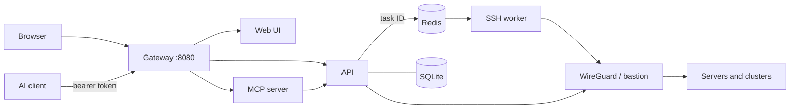

The API checks every request against the caller's grants, consumes an exact human approval when one is required, and queues only a task ID. The worker rechecks authorization before it receives an in-memory SSH configuration. Execution records keep metadata and argument digests, not raw output. Read the [architecture](docs/ARCHITECTURE.md) and [security](docs/SECURITY.md) notes for the full model.

## Local development

To build the container from your checkout instead of pulling it, add the development override. It also binds the app to loopback only:

```sh
git clone https://github.com/nooblk-98/nexusssh.git
cd nexusssh
docker compose -f docker-compose.yml -f docker-compose.dev.yml up -d --build
```

To run the services natively, you need Node.js 24 and a Redis instance on `127.0.0.1:6379`.

```sh
npm ci
npm run setup        # creates .env with generated secrets
npm run db:generate
npm run db:migrate
npm run dev          # web on :3000, API on :3001, MCP on :3002
```

| Command             | Purpose                                    |
| ------------------- | ------------------------------------------ |
| `npm run lint`      | Lint all workspaces                        |
| `npm run typecheck` | Type-check the API, worker, and web UI     |
| `npm test`          | Run unit tests with Vitest                 |
| `npm run test:e2e`  | Run Playwright browser tests               |
| `npm run build`     | Build all workspaces for production        |

REST route documentation is served at `/api/docs` on every installation.

## Documentation

| Guide                                | Contents                                                                  |
| ------------------------------------ | ------------------------------------------------------------------------- |
| [Deployment](docs/DEPLOYMENT.md)     | Hosting, HTTPS, persistent volumes, upgrades, and recovery                |
| [Operations](docs/OPERATIONS.md)     | OIDC, encrypted backups, file history, diagnostics, presets, and runbooks |
| [MCP clients](docs/CLIENTS.md)       | Client setup, authentication, tools, approvals, and task handling         |
| [Kubernetes](docs/KUBERNETES.md)     | Kubeconfig imports, consoles, commands, and private routes                |
| [VPN and bastions](docs/VPN.md)      | WireGuard configuration and combined connection paths                     |
| [Folders](docs/FOLDERS.md)           | Organizing servers and clusters                                           |
| [Architecture](docs/ARCHITECTURE.md) | Service boundaries and execution flows                                    |
| [Security](docs/SECURITY.md)         | Credential handling, permissions, and operational constraints             |
| [Verification](docs/STATUS.md)       | Current coverage and remaining work                                       |

<details>
<summary>Repository social card</summary>

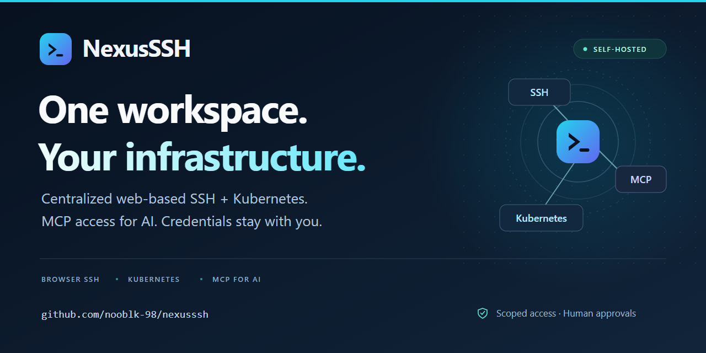

[Download PNG](docs/assets/nexusssh-social-card.png) · [Editable SVG](docs/assets/nexusssh-social-card.svg)

The PNG is **1280 × 640 pixels**. To use it for link previews, upload it under **Settings → Social preview → Edit → Upload an image**, following [GitHub's social preview guide](https://docs.github.com/en/repositories/managing-your-repositorys-settings-and-features/customizing-your-repository/customizing-your-repositorys-social-media-preview).

</details>

---

<div align="center">

Built by [Lahiru S Liyanage](https://github.com/nooblk-98) · [Release notes](CHANGELOG.md)

</div>
