# Responsive UI review

Preserves the existing slate/blue light theme and zinc/blue dark theme, typography, shared buttons, and product workflows. No new dependencies or backend changes.

## Screenshots

Real Chromium renders using synthetic API fixtures (no production data). **Before** is development commit `2372f13`; **after** is this branch. Matching 320 × 800 mobile and 1440 × 800 desktop viewports, local fonts, and settled overlay animations. Images are committed so they remain available from the PR.

| View | Before | After |
| --- | --- | --- |
| Mobile Quick Connect | 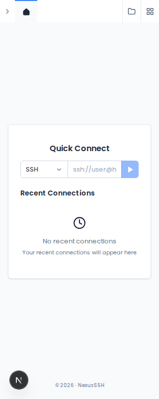 | 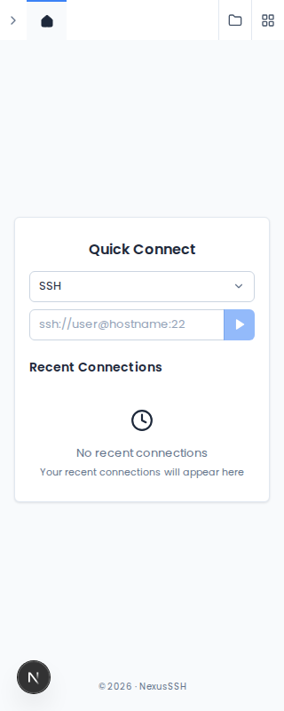 |
| Mobile command palette, light | 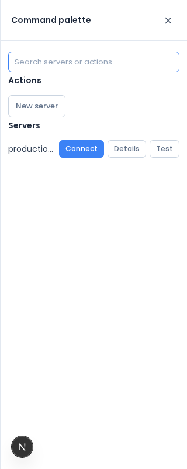 | 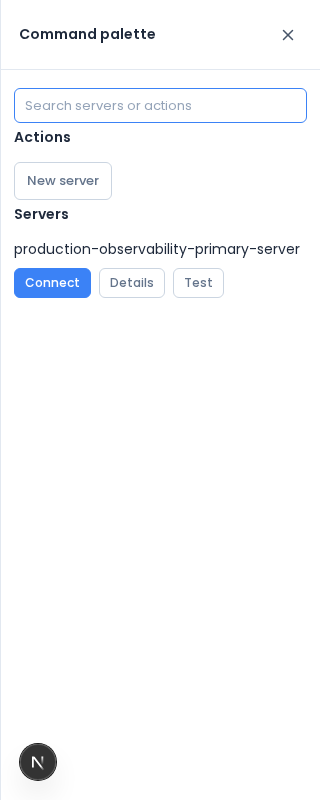 |
| Mobile command palette, dark | 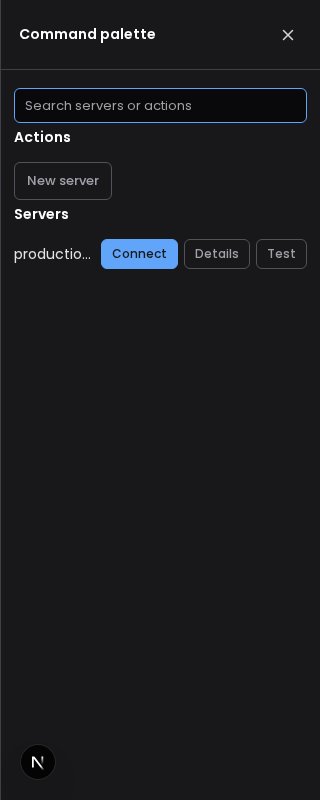 | 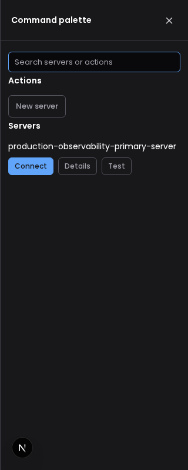 |
| Desktop command palette | 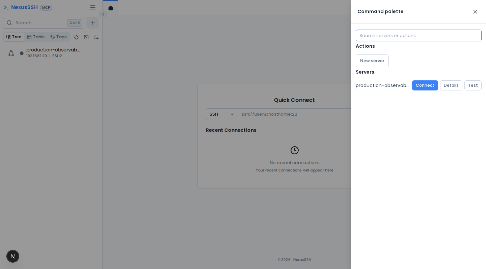 | 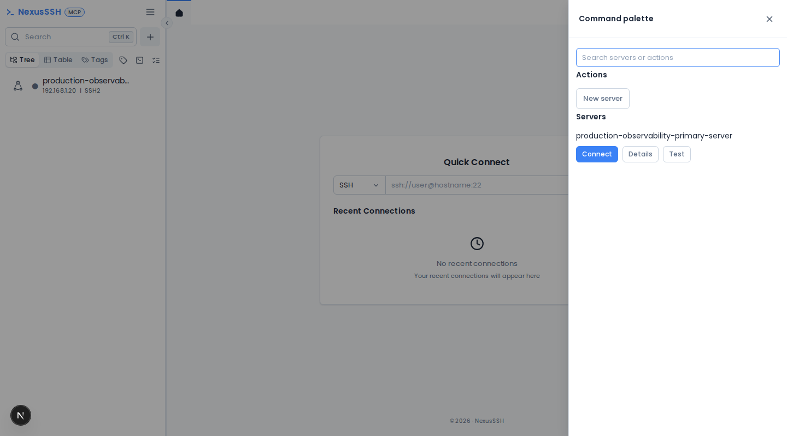 |

## Changes

- Mobile Quick Connect uses a separate protocol row to leave room for the address.
- Palette server names wrap instead of being squeezed by three action buttons.
- Shared drawers/dialogs contain keyboard focus, restore focus to their trigger, lock background scrolling, and handle nested Escape correctly.
- Menus support arrow/Home/End navigation, submenu entry/exit, focus restoration, viewport-aware placement, and height-limited scrolling. They render above drawers.
- Icon-only mobile settings navigation retains explicit accessible names, including Back; navigation targets are at least 44px tall.
- SFTP navigation wraps its path form onto its own row on phones; terminal search shrinks within its pane and has an accessible label.
- Fields/grids, batch output cards, long modal titles, and footers handle constrained space; shell/settings/modal heights respect the dynamic viewport.
- Focus outlines use the existing primary token; reduced-motion preferences suppress UI transitions/animations.

## Verification

`tests/e2e/ui-responsive.spec.ts` sweeps Home and all 16 settings routes at 320, 390, 768, 1024, and 1440px in light/dark modes, with targeted keyboard, nested-dialog, menu, SFTP, and sign-in checks. Existing populated settings-table, sidebar, Kubernetes console, cluster-folder, and routing tests cover related workflows. These UI checks use mocked APIs; they are not live SSH or cluster connectivity tests.

Run against a development web server with:

```sh
CI=1 E2E_URL=http://127.0.0.1:3100 npx playwright test ui-responsive settings-layout sidebar kubernetes-console kubernetes-routes kubernetes-folders
npm run typecheck
npm run lint
```

## 2026-11-04 follow-up: request lifecycle and status contrast

Baseline: `development` at `e377599` (including the earlier responsive review). No new dependencies, API contracts, schema, security policy, or deployment settings.

### Design system preflight

- `apps/web/app/globals.css`: slate/blue light and zinc/blue dark semantic surface, border, text and accent tokens; `--shadow`/`--shadow-lg`; mostly 6–8px radii; 8/12/16/24px spacing conventions (no standalone spacing/radius scale); primary-token focus-visible outline.
- `apps/web/components/ui.tsx`: Button, IconButton, Field, Check, SearchInput, Empty, Drawer, Dialog, DialogHost, menus, confirmDialog/promptDialog; notifications use `notify` in `lib/api.ts`.
- Settings use `components/settings/layout.tsx` and `components/settings/page-head.tsx`, `card`, `table-card`, `badge`, and `btn` classes. Heavy terminal/editor views already use dynamic imports.
- Reused installed React Query cancellation and native AbortController rather than introducing a library or custom request framework.

### Changes and evidence

- SFTP directory loads abort their predecessor and ignore cancelled success/error/finally updates; closing a tab cancels its listing. The delayed `/slow` → `/fast` regression failed on development (path reverted to `/slow`) and passes after the fix.
- `useApi` consumes React Query's AbortSignal. Leaving Operations with one stalled request previously left it outstanding (no requestfailed event within 3 seconds); now that request is aborted. Residual client requests in this fixture: **1 → 0**. This measures browser work only; aborting fetch does not guarantee server-side cancellation.
- Shared green/red badges retain their colour families but now pass 4.5:1 normal-text contrast on card surfaces: light green **2.92 → 6.33**, light red **4.02 → 5.39**, dark green **4.26 → 8.06**, dark red **3.18 → 5.56**. Dark amber and neutral badge text also use readable existing-family colours. Computed-style tests composite translucent badge backgrounds before calculating contrast.

Matching Chromium crops at 390 × 900, local fonts ready and animations disabled; before uses development CSS, after uses this branch. Only displayed before/after pairs are retained.

| Status badges | Before | After |
| --- | --- | --- |
| Light | 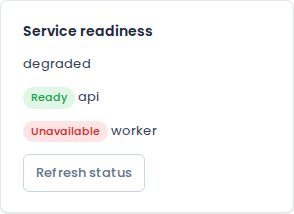 | 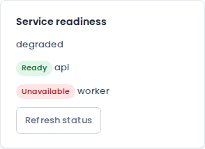 |
| Dark | 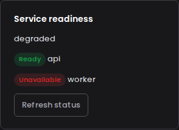 | 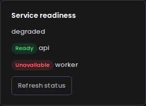 |

### Coverage and follow-ups

`review-lifecycle.spec.ts` covers both logic fixes plus contrast, focus, visibility and overflow on Operations. The existing `ui-responsive` sweep checks home/all 16 settings routes at 320, 390, 768, 1024 and 1440px in both themes. Populated settings tables, sidebar and Kubernetes specs run alongside it. These fixtures do not exhaust every drawer/menu/error/loading combination, terminal/editor split-view interaction, or every WCAG criterion. Real-device touch targets, live SSH/SFTP/cluster connectivity, backend throughput and production bundles were not measured in this round.

Backend inspection found per-server `resolveSettings` calls in `listServers`/`listServersPage`; batch resolution needs a database query-count benchmark and dedicated authorization/default-inheritance coverage before changing it. No unmeasured backend optimization was made. Primary-button contrast and a complete automated contrast inventory remain follow-ups; this round only certifies the tested readiness badges, not the entire UI.

README re-read: corrected the stale minor-image example from `0.3` to `0.4`; installer instructions, release badge and commands are unchanged. Changelog, Operations and Status are synced; no installer behavior changed.

### Verification results

- `npm run lint` and `npm run typecheck`: passed.
- `npx vitest run tests/unit`: **28 files / 202 tests passed**, with disposable synthetic DATABASE_URL/REDIS_URL and encryption/session/internal values supplied in the process environment. Initial unconfigured run could not import terminal-metrics; no production credentials were read.
- `CI=1 E2E_URL=http://127.0.0.1:3100 npx playwright test ui-responsive settings-layout sidebar kubernetes- review-lifecycle --output=/tmp/nexus-final-results`: **26 passed**. Initial overlapping browser runs collided in Playwright's output directory; the final run was sequential in a separate temporary output directory.
- `git diff --check`: passed. Local Markdown link targets in README, Changelog, Status, Operations, this review and the installer README all exist. External links and deployment commands were reviewed, not executed against production.
- Deleted fully merged `fix/responsive-ui-audit`, `fix/remove-all-approvals` and `fix/remove-ssh-approvals` branches locally/remotely after checking their tips against merged PRs #10/#9/#8 and ancestry in development. Preserved main/development and PR records.
